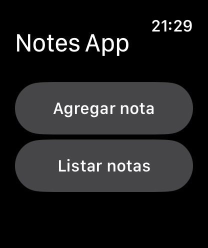

# NotesApp
### watchOS (Standalone) — SwiftUI

A standalone **Apple Watch** notes app built with **SwiftUI** in **2022**. It lets you add short notes right from your wrist, view them in a list, and open a simple detail view. Works fully **offline** and stores data **on‑device**.

  
  
  

---

## Features

* **Standalone** watch app (no iPhone companion required).
* **Add** and **list** notes with a compact, watch‑first UI.
* **Detail** screen for each note including **creation timestamp**.
* Large tap targets and clear typography for quick interactions.
* Simple, on‑device storage (no network).

> Screens are currently shown in Spanish (e.g., *Agregar nota*). Strings to localizable are pending.

## Requirements

* **Xcode 14+** (originally built in 2022).
* **watchOS 9+**.

## Build & Run

1. Open the project in Xcode.
2. Select the **Watch** scheme.
3. Run on an **Apple Watch simulator** or a **paired Apple Watch**.

## Architecture Notes

* **SwiftUI** across the watch target.
* App split into the standard **WatchKit App** + **WatchKit Extension** targets used in 2022 projects.
* A lightweight helper (`StorageTools`) encapsulates on‑device persistence for notes.
* `Note` model: text + creation `Date`.

## Usage

* Open the app → **Add note** to create a new entry.
* Use **List notes** to browse saved notes and open their **detail**.

## Localization

* Base language: Spanish (ES)

---

## Author

© 2022–2025 Kevin Menéndez
